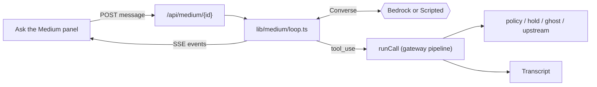

# Design Document

## Overview

The Medium is a small agent loop around Bedrock's Converse API. The loop is a pure state machine over an injectable `Model` and an injectable `callTool`, so tests run with fakes. The loop never touches Redis, the upstream, or policy directly: it calls `runCall` from the gateway.



## Modules

### `lib/medium/types.ts`

```typescript
export type MediumEvent =
  | { type: "thought"; text: string }
  | { type: "tool_call"; tool: string; args: unknown; risk: Risk }
  | { type: "tool_result"; tool: string; ok: boolean; summary: string }
  | { type: "held"; tool: string; approvalId: string }
  | { type: "final"; text: string; mode: "live" | "offline" }
  | { type: "error"; message: string };

export interface Model {
  next(messages: ConverseMessage[], tools: ToolSpec[]): Promise<ModelTurn>;
}
export type ModelTurn =
  | { kind: "text"; text: string }
  | { kind: "tool_use"; id: string; name: string; input: unknown };
```

### `lib/medium/loop.ts`

```typescript
export async function* runMedium(input: {
  message: string; history: Turn[]; tools: ToolDef[];
  model: Model; callTool: (name: string, args: unknown) => Promise<McpToolResult>;
  limits?: { turns: number; toolCalls: number };
}): AsyncGenerator<MediumEvent>;
```

Stops at the first of: a `text` turn from the model, turn limit, tool-call limit. A `held` result with status still pending ends the loop with a `final` that points to the Inbox. The same tool+args pair is never called twice in one message (dedupe), which also prevents retry loops on held calls.

### `lib/medium/bedrock.ts`

`class BedrockModel implements Model` using `ConverseCommand` with `toolConfig`. Converts `ToolDef.inputSchema` to Bedrock's `toolSpec.inputSchema.json`. Maps errors (throttling, access denied, timeout 25 s) to a typed `ModelUnavailable` error.

### `lib/medium/scripted.ts`

```typescript
export function planFromMessage(msg: string, tools: ToolDef[]): { calls: { tool: string; args: unknown }[]; reply: string } | null;
export class ScriptedModel implements Model { ... }
```

Regexes: amount `\$?\s?(\d{1,9}(?:[.,]\d{1,2})?)`, account `\b(\d{4})\b`. Tool names are located by operation name (`GetBalance`, `TransferFunds`, `CloseAccount`, `ListAccounts`), not hardcoded Gravewood ids, so it only plans when those tools exist.

### `lib/medium/budget.ts`

`async function takeBudget(): Promise<boolean>` uses `INCR medium:calls:{YYYY-MM-DD}` with 2-day TTL; returns false when over `MEDIUM_DAILY_CALL_CAP`. Per-IP and per-service limits use `hit()` from the Gravewood store (move `hit` to `lib/rate-limit.ts` in a small refactor).

### `app/api/medium/[id]/route.ts`

Validates body with zod; loads the service; builds tools; picks `BedrockModel` if `takeBudget()` succeeds and env is configured, else `ScriptedModel`; on `ModelUnavailable` mid-run switches to `ScriptedModel` for that message. Streams `text/event-stream`; aborts on client disconnect.

### `components/MediumPanel.tsx`

`fetch` with `ReadableStream` reader parsing SSE; renders steps; cancel via `AbortController`.

## Correctness Properties

### Property 33: Loop terminates within limits
For any fake model (random sequence of text and tool_use turns), the loop ends and emits at most `turns` model calls and `toolCalls` tool calls.

### Property 34: Same call never repeats
For any fake model that requests the same tool and args repeatedly, `callTool` is invoked once.

### Property 35: Medium cannot bypass policy
For any fake model and any destructive tool, with default rules and a `callTool` built from the real pipeline with fakes, the upstream fake is never called before the approval is approved.

### Property 36: Tool results are data
For any tool result text containing instruction-like strings, the messages sent to the model mark it only as a `toolResult` block and the system prompt is unchanged.

### Property 37: Scripted planner only plans existing tools
For any message and any tool list, every planned call names a tool in the list.

## Testing Strategy

- Unit tests for scripted planner (balance, transfer, close, nonsense).
- Property tests 33–37 with fakes.
- Route test with a fake model streaming SSE; verify event order.
- E2E: demo flow with Scripted_Medium (forced by env `MEDIUM_FORCE_OFFLINE=1`) so CI needs no AWS.
- Manual: one live Bedrock run recorded for the demo video.
