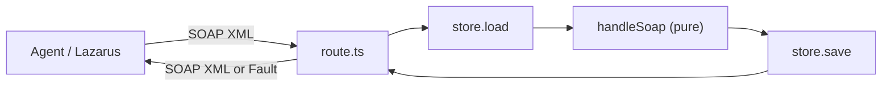

# Design Document

## Overview

Gravewood Bank is a small SOAP server implemented as Next.js route handlers. The core is a **pure** function `handleSoap(state, action, xml) → { state', xml, status }`, so every behaviour is unit- and property-testable without HTTP or Redis. Routes only load state, call the handler, and save state.

```
POST /api/gravewood/sandboxes          create sandbox
GET  /api/gravewood/{id}/wsdl          WSDL
POST /api/gravewood/{id}               SOAP endpoint
POST /api/gravewood/{id}/reset         restore seed
```



## Modules

### `lib/gravewood/types.ts`

```typescript
export type AccountStatus = "OPEN" | "CLOSED";
export type Account = {
  id: string; name: string; balanceCents: number;
  status: AccountStatus; openedOn: string; closedAt?: string; address?: string;
};
export type Txn = {
  id: string; accountId: string; ts: string; description: string;
  amountCents: number; memo: string | null;
};
export type BankState = { accounts: Account[]; txns: Txn[]; nextConfirmation: number; };
export type HandlerResult =
  | { ok: true;  state: BankState; xml: string; status: 200 }
  | { ok: false; state: BankState; xml: string; status: 500 | 400 | 413 };
```

### `lib/gravewood/money.ts`

```typescript
export function parseAmountToCents(s: string): number | null; // null when invalid (see Req 4.2)
export function formatCents(c: number): string;                // "12450.00"
```

Parse with a regex `^\d{1,12}(\.\d{1,2})?$`, then integer arithmetic. No `parseFloat`.

### `lib/gravewood/seed.ts`

`seedState(): BankState` returns fresh data (Req 3). Timestamps are constants, never `Date.now()`.

### `lib/gravewood/xml.ts`

Uses `fast-xml-parser` (`XMLParser` with `processEntities: false`, `ignoreDeclaration: true`, `removeNSPrefix: true`, `isArray` for known repeating tags) and `XMLBuilder`. Rejects any document containing `<!DOCTYPE` before parsing.

### `lib/gravewood/handler.ts`

```typescript
export function handleSoap(
  state: BankState, soapAction: string | null, bodyXml: string, nowIso: string,
): HandlerResult;
```

1. Reject `<!DOCTYPE`; parse; locate `Envelope/Body/<Operation>`.
2. Compare the operation with `SOAPAction` (`urn:gravewood:<Operation>`, optionally quoted).
3. Dispatch to a per-operation function; each returns `{ state, result } | Fault`.
4. Build the response `<soap:Envelope>` using the operation's `<Operation>Response` element, namespace `urn:gravewood`.

Faults: `fault("Client" | "Server", message)` builds the SOAP 1.1 Fault XML; messages come from a closed set of constants so no internal detail can leak.

### `lib/gravewood/wsdl.ts`

`buildWsdl(endpointUrl: string): string`: a template literal with the schema inline. The same output is saved once as `fixtures/gravewood.wsdl` by a test using a placeholder endpoint, and a test asserts the live output equals the fixture after substituting the endpoint.

### `lib/gravewood/store.ts`

| Key | Type | TTL |
|---|---|---|
| `gw:{id}` | JSON string (BankState) | 3600 s, refreshed on write |
| `gw-rl:{id}` | counter | 60 s |
| `gw-create-rl:{ip}` | counter | 60 s |

```typescript
export async function createSandbox(): Promise<{ id: string; expiresAt: string }>;
export async function loadState(id: string): Promise<BankState | null>;
export async function saveState(id: string, s: BankState): Promise<void>;
export async function resetSandbox(id: string): Promise<boolean>;
export async function hit(key: string, limit: number, windowSec: number): Promise<boolean>; // INCR+EXPIRE
```

**Concurrency:** a transfer is read-modify-write. Use an optimistic version field: `saveState` does `SET` only if the stored `version` equals the loaded one (Lua via `redis.eval` or `WATCH`-equivalent); on conflict, retry up to 3 times, then return a Server Fault "Please retry".

### Routes

All with `export const runtime = "nodejs"`.

- `app/api/gravewood/sandboxes/route.ts`: POST. Rate-limited by IP (`x-forwarded-for`, first value).
- `app/api/gravewood/[id]/route.ts`: POST (SOAP). Checks size, rate limit, loads state, calls `handleSoap`, saves, returns `text/xml; charset=utf-8`.
- `app/api/gravewood/[id]/wsdl/route.ts`: GET.
- `app/api/gravewood/[id]/reset/route.ts`: POST.

### Dev override

`lib/env.ts` gains `LAZARUS_DEV_ALLOW_LOOPBACK` (boolean, default false). `safeFetch` consults it only when `NODE_ENV !== "production"`. (Touches the `summon` fetcher; keep this change tiny and covered by a test that proves production ignores it.)

## Correctness Properties

### Property 11: Transfers conserve money
For any seeded state and any sequence of random transfer attempts (valid and invalid), the sum of `balanceCents` is unchanged and no balance is negative.

### Property 12: Failed operations change nothing
For any request that returns a Fault, the returned state deep-equals the input state.

### Property 13: Amount parsing round-trip
For any integer cents `c ≥ 1`, `parseAmountToCents(formatCents(c)) === c`; for any string failing the regex, the result is `null`.

### Property 14: Sandbox isolation
Operations applied to one sandbox's state never alter another's (test with two stores in memory).

### Property 15: Faults leak nothing
For arbitrary garbage input strings, the response is a well-formed Fault and contains none of: `at `, `node_modules`, `/home`, `gw:`.

## Testing Strategy

- Unit tests per module (`tests/gravewood/*.test.ts`), handler tested with plain strings.
- Property tests 11–15 with fast-check.
- Contract test: `tests/gravewood/contract.test.ts` parses `fixtures/gravewood.wsdl` with the real Lazarus parser, builds envelopes via the real translator for each operation, runs them through `handleSoap`, and parses responses back.
- Store tests use an in-memory fake implementing the same interface as the Upstash client.
- E2E (`e2e/gravewood.spec.ts`): create a sandbox, fetch the WSDL, call `GetBalance` with `fetch`.
