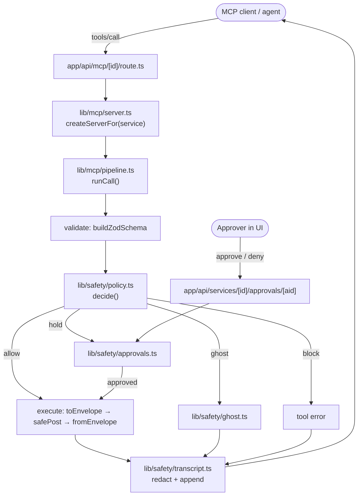

# Design Document

## Overview

The Gateway is a stateless MCP server created per request from a stored `ServiceDefinition`. All safety logic lives in small pure modules under `lib/safety/`, so it can be property-tested without MCP or Redis. MCP and Redis are thin shells.



## Dependencies

- `@modelcontextprotocol/sdk`: `McpServer` and `WebStandardStreamableHTTPServerTransport` (stateless: `sessionIdGenerator: undefined`, `enableJsonResponse: true`).
- Reuses from `summon`: `buildZodSchema`, `toEnvelope` (returns `{ ok, xml, headers }`), `fromEnvelope`, `getService` (returns `{ ok, value }`), and `generateOwnerToken`/`verifyOwnerToken`/`publicDefinition` from `lib/owner-token.ts`.
- New in this spec: `safePost` in `lib/soap/fetcher.ts` (below). `safeFetch` is GET-only and rejects every non-200, so it cannot carry a SOAP call.

## Data models (`lib/safety/types.ts`)

```typescript
import type { Risk } from "../soap/types"; // single definition lives in lib/soap/types.ts; do not redeclare
export type Effect = "allow" | "hold" | "block";
export type CondOp = "gt" | "gte" | "lt" | "lte" | "eq" | "neq" | "contains";

export type Condition = { field: string; op: CondOp; value: string | number | boolean };
export type Rule = {
  id: string; operation: string; // operation name or "*"
  when?: Condition; effect: Effect; reason: string; // reason <= 200 chars
};
export type Decision =
  | { action: "allow" | "hold" | "block" | "ghost"; ruleId?: string; reason: string };

export type ApprovalStatus = "pending" | "approved" | "denied" | "expired" | "executed";
export type Approval = {
  id: string; serviceId: string; tool: string; args: unknown; // args already redacted? NO: raw args needed to execute; see below
  risk: Risk; reason: string; status: ApprovalStatus;
  createdAt: string; expiresAt: string; resolvedAt?: string; note?: string;
};
export type TranscriptEntry = {
  id: string; ts: string; tool: string; args: unknown; risk: Risk;
  decision: Decision["action"]; ruleId?: string; approvalId?: string;
  outcome: "ok" | "fault" | "error" | "held" | "blocked" | "ghost";
  durationMs: number; soapRequest?: string; soapResponse?: string; summary: string;
};
```

> **Approval args & secrets:** the Approval stores the real arguments (needed to execute) under key `approval:{svc}:{id}`; the UI-facing API returns `redact(args)`. Arguments containing redactable keys are still stored, with the Redis TTL of 900 s, and never logged.

## Modules

### `lib/safety/policy.ts` (pure)

```typescript
export function decide(input: {
  op: OperationSchema; risk: Risk; args: unknown;
  rules: Rule[]; ghost: boolean;
}): Decision;
```

Algorithm:
1. `matching` = rules where `(rule.operation === op.name || rule.operation === "*")` and `holds(rule.when, args)`. A condition that throws or cannot be evaluated counts as holding (fail closed).
2. If any matching rule has `block` → `{ block, ruleId, reason }`.
3. If `ghost && risk !== "read"` → `{ ghost }`.
4. If any matching rule has `hold` → `{ hold, ruleId }`.
5. If risk is `destructive` and no matching rule with `allow` **that names the operation explicitly** → `{ hold, reason: "Destructive operation" }`.
6. Else `{ allow }`.

`getPath(args, "a.b")` safely walks plain objects (no prototype access: reject segments `__proto__`, `constructor`, `prototype`).

### `lib/safety/redact.ts` (pure)

```typescript
export const SENSITIVE = /pass(word)?|secret|token|api[-_]?key|authorization|credential|ssn/i;
export function redactJson(v: unknown): unknown;     // deep; key-based
export function redactXml(xml: string): string;       // element local-name based, regex over <ns:name>value</ns:name>
export function truncate(s: string, max: number): string;
```

### `lib/safety/approvals.ts`

| Key | Type | TTL |
|---|---|---|
| `approval:{svc}:{id}` | Hash (Approval JSON, `claimed`) | 900 s |
| `approvals:{svc}` | List of ids (LPUSH, LTRIM 0 49) | 30 d |

```typescript
export async function createApproval(svc: string, a: Omit<Approval,"id"|"status"|"createdAt"|"expiresAt">): Promise<Approval>;
export async function getApproval(svc: string, id: string): Promise<Approval | null>;   // applies expiry
export async function resolveApproval(svc: string, id: string, d: "approve"|"deny", note?: string): Promise<"ok"|"not_found"|"conflict">;
export async function claimExecution(svc: string, id: string): Promise<boolean>;        // HSETNX claimed 1 → true only for first caller
export async function listApprovals(svc: string): Promise<Approval[]>;
```

`resolveApproval` is a compare-and-set: Lua script sets `status` only when it currently equals `pending`. `claimExecution` uses `HSETNX`; after success the pipeline sets status `executed`.

### `lib/safety/ghost.ts` (pure)

`ghostResponse(op: OperationSchema): unknown` builds a deterministic sample object from `outputDescriptor`: strings → `"ghost-<fieldName>"`, ints → 1, decimals → `"0.00"`, booleans → true, dateTime → fixed ISO, arrays → one element, optional → omitted, nillable → null.

### `lib/safety/transcript.ts`

```typescript
export async function appendTranscript(svc: string, e: TranscriptEntry): Promise<void>; // LPUSH + LTRIM 0 199 + EXPIRE 30d
export async function listTranscripts(svc: string, since?: string): Promise<TranscriptEntry[]>;
```

Redaction is applied inside `appendTranscript` (defence in depth), not only by callers.

### `safePost` (added to `lib/soap/fetcher.ts`)

```typescript
export async function safePost(url: string, req: {
  body: string; headers: Record<string, string>; timeoutMs?: number; maxBytes?: number;
}): Promise<{ ok: true; status: number; body: string } | { ok: false; error: LazarusError }>;
```

Shares the SSRF machinery of `safeFetch` (DNS pinning through the custom `lookup`, blocked ranges, IP-literal check, dev loopback flag honoured only outside production) by generalising `requestOnce` to take a method, headers and body. Differences from `safeFetch`: method is always `POST`; request headers are limited to an allowlist (`Content-Type`, `SOAPAction`) plus a fixed `User-Agent`; **redirects are never followed** (any 3xx returns a failure, so a hostile upstream cannot bounce the call to an internal address); every HTTP status is returned to the caller with its body (a SOAP Fault arrives as HTTP 500); request body is capped at 256 KB; default timeout 25 000 ms; response cap 5 MB. The caller must pass the bytes from `toEnvelope` and read the response with `fromEnvelope`, which parses untrusted XML safely.

### `lib/mcp/tools.ts`

```typescript
export type ToolDef = { name: string; op: OperationSchema; port: string; description: string; inputSchema: object; annotations: {...} };
export function buildTools(service: ServiceDefinition): ToolDef[];
export function sanitizeToolName(raw: string, taken: Set<string>): string;
```

### `lib/mcp/pipeline.ts`

```typescript
export async function runCall(ctx: {
  service: ServiceDefinition; tool: ToolDef; args: unknown; clientIp: string;
  deps: Deps;   // registry, approvals, transcript, fetch, clock — all injectable
}): Promise<McpToolResult>;
```

`Deps` makes the pipeline testable with in-memory fakes. The pipeline never imports Redis directly.

### `lib/mcp/server.ts`

`createServerFor(service, deps): McpServer` registers each ToolDef with `server.registerTool(...)` using a raw JSON-schema-compatible zod shape, and registers `check_approval` (`{ approvalId: string }`).

### `lib/auth/owner.ts`

Thin module. Token generation, hashing and constant-time verification already exist in `lib/owner-token.ts` (`generateOwnerToken`, `hashOwnerToken`, `verifyOwnerToken`, `publicDefinition`); do not reimplement them.

```typescript
export async function authorizeOwner(service: ServiceDefinition, presented: string | null): Promise<boolean>; // verifyOwnerToken against service.ownerTokenHash; false when no hash or no token
export function isDemoService(wsdlUrl: string, ownOrigin: string): boolean;
```

### Routes

- `app/api/mcp/[id]/route.ts`: `POST` creates a transport and server per request, `OPTIONS` for CORS, other methods 405.
- `app/api/services/[id]/route.ts`: GET summary.
- `app/api/services/[id]/rules/route.ts`: PUT.
- `app/api/services/[id]/settings/route.ts`: PATCH.
- `app/api/services/[id]/approvals/route.ts`: GET.
- `app/api/services/[id]/approvals/[aid]/route.ts`: POST.
- `app/api/services/[id]/transcripts/route.ts`: GET.

No route exports `runtime` (rejected by `cacheComponents: true`).

## Correctness Properties

### Property 16: Destructive never runs unattended by default
For any destructive operation, any arguments, and any rule set with no explicit `allow` naming the operation, `decide` never returns `allow`.

### Property 17: Most restrictive rule wins
For any set of matching rules, the decision's strictness (`block > ghost > hold > allow`) is ≥ the strictness of each matching rule's effect, except where ghost mode replaces hold.

### Property 18: Fail closed on bad conditions
For any rule whose condition has a non-numeric value compared with `gt/gte/lt/lte` against any argument, the rule is treated as matching.

### Property 19: Redaction removes every sensitive value
For any JSON object containing keys matching `SENSITIVE` at any depth with random string values, `JSON.stringify(redactJson(obj))` contains none of those values.

### Property 20: Ghost never calls upstream
For any service, operation and arguments with `ghost: true` and a non-read risk, the injected fetch fake is called zero times and the result carries `ghost: true`.

### Property 21: Approvals execute at most once
For any number N ≥ 1 of concurrent `check_approval` calls on one approved Approval, exactly one executes upstream (the fetch fake is called once).

### Property 22: Approval executes with stored arguments
For any Approval and any arguments passed to `check_approval`, the arguments sent upstream equal the stored arguments.

### Property 23: Tool names are valid and unique
For any list of operation names (including duplicates, unicode and very long names), `buildTools` yields names matching `^[A-Za-z0-9_-]{1,64}$`, all distinct.

### Property 24: Owner token never leaks
For any sequence of API calls, no response body or transcript entry contains the plaintext token or its hash.

## Error Handling

- Domain errors become MCP tool results with `isError: true` and short sentences; internals are logged server-side only (Property 10 from `summon` applies: ≤ 500 chars, no stack traces).
- Redis failure on transcript append never fails the call (log and continue); Redis failure on Approval create returns a tool error and the call is NOT executed (fail closed).

## Testing Strategy

- Unit: policy, redact, ghost, tools, owner (pure, fast).
- Property: 16–24 with fast-check.
- Pipeline tests with in-memory fakes for approvals, transcript, fetch.
- Integration: MCP SDK `Client` against the route handler using the Gravewood bank handler as upstream (no network).
- E2E (Playwright): summon the Gravewood sandbox, call `CloseAccount` through the MCP endpoint with `fetch`, assert it is held, approve through the API, assert the account closed.
