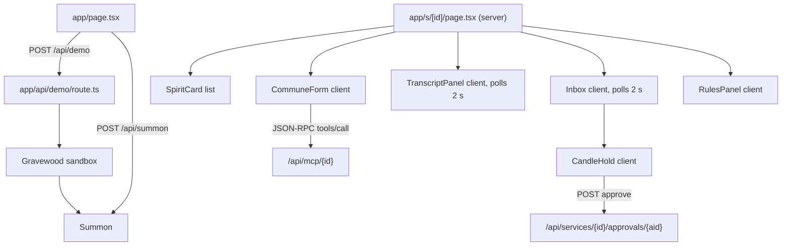

# Design Document

## Overview

Server components fetch initial data; small client components handle polling, forms and the candle. Logic that can be tested without a browser lives in pure helpers (`lib/ui/*`): form schema derivation, rule-to-English, hold-timer state machine. The Candle_Hold is a state machine tested with fake timers; Playwright proves it end to end.



## Files

```
app/
  page.tsx                         Home (server) + <SummonForm/> client
  s/[id]/page.tsx                  Service page (server component)
  s/[id]/not-found.tsx             "This spirit has passed on"
  api/demo/route.ts                Demo_Bootstrap
components/
  SummonForm.tsx
  SpiritCard.tsx
  RiskBadge.tsx
  CommuneForm.tsx
  TranscriptPanel.tsx
  Inbox.tsx
  CandleHold.tsx
  RulesPanel.tsx
  GhostSwitch.tsx
  McpConfig.tsx
lib/ui/
  form-model.ts                    FieldDescriptor[] -> form field tree + default values
  rule-text.ts                     Rule -> English sentence
  hold-machine.ts                  Candle_Hold state machine (pure)
  token-store.ts                   localStorage wrapper with try/catch
  poll.ts                          visibility-aware polling hook helper
```

## Key designs

### `lib/ui/hold-machine.ts` (pure)

```typescript
export const HOLD_MS = 2000;
export type HoldState =
  | { kind: "idle" }
  | { kind: "holding"; startedAt: number }
  | { kind: "released" }       // approve sent
  | { kind: "error"; message: string };

export type HoldEvent =
  | { type: "down"; at: number }
  | { type: "up"; at: number }
  | { type: "cancel" }                // pointer leave / blur / pointercancel
  | { type: "tick"; at: number }
  | { type: "sent" }
  | { type: "failed"; message: string };

export function reduce(s: HoldState, e: HoldEvent): { state: HoldState; effect?: "send" };
```

- `down` while `idle` → `holding`. `down` while already `holding` is ignored (so key auto-repeat cannot restart the timer).
- `tick` while `holding` with `at - startedAt >= HOLD_MS` → `{ state: held-complete, effect: "send" }` once.
- `up` / `cancel` before completion → `idle`, no effect.
- After `released`, every event is ignored.

The component drives the machine from: `onPointerDown/Up/Leave/Cancel` (with `setPointerCapture`), `onKeyDown/Up` for Space and Enter (ignoring `event.repeat`), a `setInterval` of 50 ms for ticks, and `onContextMenu={e => e.preventDefault()}`. The ring and flame are CSS (`@keyframes` bound to a `--hold` custom property set from the machine's elapsed value), disabled under `prefers-reduced-motion`.

### Non-timed alternative
A checkbox + "Approve" button path calls the same `send` function with no timer. Both paths share one `useApprove(approvalId)` hook that guarantees a single in-flight request.

### `lib/ui/form-model.ts`

```typescript
export type FormField =
  | { kind: "text" | "number" | "boolean" | "datetime"; name: string; required: boolean; nillable: boolean; list: boolean }
  | { kind: "group"; name: string; required: boolean; list: boolean; children: FormField[] };
export function toFormModel(desc: FieldDescriptor[]): FormField[];
export function toArguments(model: FormField[], values: unknown): unknown; // drops empty optionals, converts numbers
```

Validation reuses `buildZodSchema(desc)` from `lib/soap`.

### `lib/ui/rule-text.ts`

`ruleToEnglish(rule: Rule): string`, e.g. `Hold TransferFunds when amount is greater than 1000 — "Large transfer"`. Operators map: `gt` "is greater than", `gte` "is at least", `lt` "is less than", `lte` "is at most", `eq` "equals", `neq` "does not equal", `contains` "contains".

### `app/api/demo/route.ts`

Calls `createSandbox()`, builds `${origin}/api/gravewood/${id}/wsdl`, then calls the shared summon function (the same one `/api/summon` uses, extracted into `lib/summon/index.ts`) so no logic is duplicated. Rate limit via `hit("demo:ip", 10, 60)` and `hit("demo:global", 500, 3600)`.

### Polling

`usePolling(fn, 2000)` pauses on `document.visibilityState === "hidden"`, uses `AbortController`, backs off to 10 s after 3 consecutive errors, and never overlaps requests.

### Theme

CSS variables from `ui-seance.md`; fonts via `next/font` (Cinzel, Inter, JetBrains Mono). Risk colours: calm `#4fd1c5`, restless `#f6ad55`, vengeful `#ff6b5b` on `#14101c`; all verified ≥ 4.5:1.

## Correctness Properties

### Property 28: Hold machine never sends before 2000 ms
For any sequence of events with timestamps, `effect: "send"` is produced only when a continuous `down`…`tick` span of at least `HOLD_MS` exists with no intervening `up` or `cancel`.

### Property 29: Hold machine sends at most once
For any event sequence, at most one `send` effect is produced.

### Property 30: Key auto-repeat cannot restart or shorten the hold
For any sequence containing repeated `down` events while holding, the earliest completion time equals the first `down` time plus `HOLD_MS`.

### Property 31: Form arguments validate
For any descriptor tree and any values generated from its form model, `toArguments` output passes `buildZodSchema(desc)`.

### Property 32: Rule text is total
For any valid Rule, `ruleToEnglish` returns a non-empty string under 300 characters containing the operation name.

## Testing Strategy

- Unit and property tests for `lib/ui/*` (Properties 28–32), `hold-machine` with fake timers.
- Component tests (Vitest + Testing Library): CandleHold early release sends nothing; checkbox alternative; Inbox 409 message.
- Playwright E2E: (a) raise demo, call `CloseAccount` from the Commune_Form, see Held in transcript, hold the candle 2.2 s, see the account closed in transcript; (b) a 1 s hold releases nothing; (c) `axe` on Home and Service pages; (d) 360 px viewport has no horizontal scroll.
- Manual checklist in `KIRO_LOG.md`: VoiceOver/NVDA pass on the Inbox.
