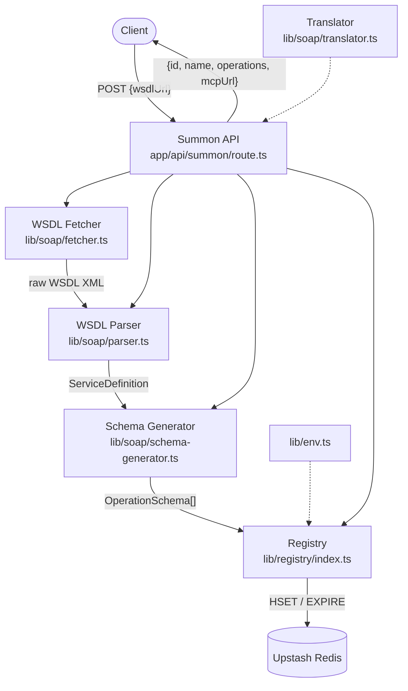

# Design Document

## Overview

The **summon** feature is the entry point for Lazarus. A user or caller submits a WSDL URL; the system fetches the document, parses every SOAP operation, converts each operation's message schema to a zod-inferred JSON Schema, and saves the result in Upstash Redis under a short stable id. Subsequent features (the MCP endpoint and the UI) look up that id to serve and call the operations.

The design is built around a strict single-responsibility pipeline:

```
HTTP POST /api/summon
  ↓ zod input validation
  ↓ SSRF-safe WSDL fetch  (lib/soap/fetcher.ts)
  ↓ WSDL parse            (lib/soap/parser.ts)
  ↓ JSON Schema generation (lib/soap/schema-generator.ts)
  ↓ Registry upsert       (lib/registry/index.ts)
  ↓ JSON response
```

Every cross-cutting concern (typed env, error codes, data models) lives in dedicated modules so that no module depends on more than its direct neighbours.

---

## Architecture

### Component Diagram



> **Note:** `Translator` is shown separately because it is the sole module that builds and parses SOAP envelopes. The API pipeline does not call it at summon time; it is invoked per-tool-call by the MCP endpoint. The diagram includes it to establish the module boundary.

### Error Propagation

Each module returns a typed `Result<T, LazarusError>` discriminated union. The API layer maps `LazarusError.code` to HTTP status and a safe user-facing message; internal details are logged server-side only.

```
LazarusError.code           HTTP status   JSON code
────────────────────────────────────────────────────
INVALID_REQUEST             400           INVALID_REQUEST
SSRF_BLOCKED                400           SSRF_BLOCKED
WSDL_TOO_LARGE              422           WSDL_TOO_LARGE
WSDL_FETCH_FAILED           502           WSDL_FETCH_FAILED
TIMEOUT                     504           WSDL_FETCH_FAILED  ← internal only; client sees WSDL_FETCH_FAILED
WSDL_PARSE_FAILED           422           WSDL_PARSE_FAILED
REGISTRY_UNAVAILABLE        503           REGISTRY_UNAVAILABLE
INTERNAL_ERROR              500           INTERNAL_ERROR
```

---

## Components and Interfaces

### `lib/env.ts`

```typescript
import { z } from "zod";

const EnvSchema = z.object({
  UPSTASH_REDIS_REST_URL:   z.string().url(),
  UPSTASH_REDIS_REST_TOKEN: z.string().min(1),
  // Optional: override for tests
  NODE_ENV: z.enum(["development", "test", "production"]).default("production"),
});

export type Env = z.infer<typeof EnvSchema>;

export function getEnv(): Env {
  return EnvSchema.parse(process.env);
}
```

Never import `process.env` directly elsewhere; always call `getEnv()`.

---

### `lib/soap/fetcher.ts`

**Responsibilities:** fetch a WSDL URL with SSRF protection, redirect tracking, timeout, and size cap. Exposes `safeFetch` as the single shared HTTP client used by ALL outbound requests: WSDL document fetch, schemaLocation imports, and any imports the soap library would otherwise make on its own.

```typescript
export type FetchResult =
  | { ok: true;  xml: string; finalUrl: string }
  | { ok: false; error: LazarusError };

export async function fetchWsdl(rawUrl: string): Promise<FetchResult>
```

**Algorithm — `fetchWsdl`:**

1. Validate `rawUrl` with zod `z.string().url()` and check scheme is `http` or `https`. On failure → `INVALID_REQUEST`.
2. URL length ≤ 2048 already enforced by API layer; fetcher trusts this.
3. Enter redirect loop (max 5 hops, `remainingHops = 5`):
   a. Resolve hostname to IP via `dns.promises.lookup({ all: true })`.
   b. Pass every resolved IP through `isBlockedIp(ip)`. If any is blocked → `SSRF_BLOCKED`.
   c. Open `https.request` / `http.request` using a **custom `lookup` function** passed in the request options (the `lookup` option accepted by Node.js `http.request` / `https.request`). The custom lookup resolves the hostname, validates every returned IP against `isBlockedIp`, and passes the validated IP to the callback — so Node.js dials that exact IP without re-resolving. TLS still performs certificate validation against the original hostname because the `hostname` option is unchanged; the custom `lookup` only controls which IP is dialled. This is the correct DNS-rebinding defence: the hostname is never substituted with a bare IP, and TLS remains valid. Set `timeout: 10_000` ms.
   d. On `timeout` event → `TIMEOUT`.
   e. If response status is 3xx and `Location` header present and `remainingHops > 0`: decrement hop counter, update URL to `Location`, continue loop.
   f. If redirects exhausted (status 3xx but `remainingHops === 0`) → `WSDL_FETCH_FAILED` with redirect message.
   g. If status ≠ 200 → `WSDL_FETCH_FAILED` with status code in message.
   h. If `Content-Length` header > 5 242 880 → `WSDL_TOO_LARGE` immediately.
   i. Stream body, accumulate bytes; if total > 5 242 880 → `WSDL_TOO_LARGE`.
   j. Decode as UTF-8; return `{ ok: true, xml, finalUrl }`.

**`safeFetch(url: string, options?: SafeFetchOptions): Promise<SafeFetchResult>`**

A lower-level primitive called by `fetchWsdl` and injected wherever the soap library would make its own network requests (e.g. XSD imports, schemaLocation URLs). It carries out SSRF IP resolution, blocked-range check, size cap, and timeout — so every outbound byte goes through the same gate.

The `soap` npm library must never make autonomous network requests. Achieve this by:
1. Passing `safeFetch` as the custom HTTP(S) client/resolver option when constructing the soap `WSDL` object (e.g. via `customDeserializer` or equivalent injection point the library exposes).
2. Where the library offers no injection point for a specific import type, pre-resolve and inline all external XSD schemas by fetching them via `safeFetch` before handing the WSDL string to the library.

**Test requirement:** Add a test in `tests/soap/fetcher.test.ts` that constructs a valid WSDL string whose `<xsd:import>` or `schemaLocation` points to `http://127.0.0.1/evil.xsd` and asserts that `parseWsdl` (or the import resolution step) returns `{ ok: false, error: { code: "SSRF_BLOCKED" } }` without making any outbound request.

**`isBlockedIp(ip: string): boolean`** — pure function, property-testable. Used by the custom `lookup` callback — never called after the connection is open.

```typescript
export function isBlockedIp(ip: string): boolean
```

Checks membership in: unspecified (`0.0.0.0/8`, `::`), loopback (`127.0.0.0/8`, `::1`), private (`10.0.0.0/8`, `172.16.0.0/12`, `192.168.0.0/16`, `fc00::/7`), link-local (`169.254.0.0/16`, `fe80::/10`), cloud-metadata (`169.254.169.254/32`, `fd00:ec2::254/128`), IPv4-mapped IPv6 (`::ffff:0:0/96`). Uses bitwise integer arithmetic; no external dependencies.

---

### `lib/soap/parser.ts`

**Responsibilities:** turn raw WSDL 1.1 XML into an internal `ServiceDefinition`.

```typescript
export type ParseResult =
  | { ok: true;  service: ServiceDefinition }
  | { ok: false; error: LazarusError };

export async function parseWsdl(xml: string): Promise<ParseResult>
```

**Algorithm — `parseWsdl`:**

1. Parse XML with the `soap` npm package's `WSDL` class (`new soap.WSDL(xml, baseUrl, options)`). On XML syntax error → `WSDL_PARSE_FAILED` with line/column from parser.
2. Check root element namespace and local name:
   - `http://schemas.xmlsoap.org/wsdl/` + `definitions` → proceed.
   - `http://www.w3.org/ns/wsdl` + `description` → `WSDL_PARSE_FAILED` with "WSDL 2.0 is not supported yet."
   - Anything else → `WSDL_PARSE_FAILED` with "Not a recognised WSDL document."
3. If no `<service>` elements found → `WSDL_PARSE_FAILED` with "No services found in the WSDL."
4. For each `<binding>`:
   - Extract transport namespace from `soap:binding` or `soap12:binding`.
   - SOAP 1.1: `http://schemas.xmlsoap.org/soap/http` ✓
   - SOAP 1.2: `http://www.w3.org/2003/05/soap/bindings/HTTP/` ✓
   - Other transport: skip binding, add warning `{ code: "UNSUPPORTED_BINDING", message: "Binding <name> uses an unsupported transport and was skipped." }`.
5. For each accepted binding, collect `(operationName, portTypeName, bindingStyle, soapVersion)` tuples.
6. **Deduplication:** group tuples by `(portTypeName, operationName)`. When both `"1.1"` and `"1.2"` are present → single `OperationSchema` with `soapVersions: ["1.1","1.2"]`, `preferredVersion: "1.1"`. Otherwise single version.
7. Determine `bindingStyle` per operation:
   - `document/literal`, `rpc/literal`, `document/encoded` → record as-is.
   - `rpc/encoded` → record as `"rpc/encoded"`, add warning.
   - Cannot determine → `"unknown"`.
8. Resolve external `schemaLocation` URLs with 10 s timeout each. On failure: add `{ code: "SCHEMA_FETCH_FAILED", message: "Could not fetch schema at <url>." }` to warnings; continue.
9. Return `ServiceDefinition`.

---

### `lib/soap/schema-generator.ts`

**Responsibilities:** convert `ServiceDefinition` message parts to zod schemas and JSON Schema objects.

```typescript
export function generateSchemas(
  service: ServiceDefinition,
): OperationSchemaMap

export type OperationSchemaMap = Map<string, OperationSchema>;
```

**XSD → zod mapping table (pure function `xsdTypeToZod`):**

| XSD type | zod |
|---|---|
| `string` | `z.string()` |
| `int`, `integer`, `long`, `short` | `z.number().int()` |
| `decimal`, `float`, `double` | `z.number()` |
| `boolean` | `z.boolean()` |
| `dateTime` | `z.string().datetime({ offset: true, local: true })` |
| `date` | `z.string()` (ISO 8601 `YYYY-MM-DD`) |
| any other | `z.unknown()` + push warning |

**Modifiers (applied after base type, pure):**

```
minOccurs="0"                  → .optional()
nillable="true"                → .nullable()
minOccurs="0" + nillable="true"→ .optional().nullable()
maxOccurs > 1 or "unbounded"   → z.array(baseType)
```

The resulting zod schema is serialised to JSON Schema via `z.toJSONSchema(zodSchema)`.

Updated exported API:

```typescript
// Builds a zod schema from a descriptor tree (used at runtime, not stored)
export function buildZodSchema(descriptors: FieldDescriptor[]): z.ZodObject<...>

// Generates the full OperationSchemaMap from a ServiceDefinition
export function generateSchemas(service: ServiceDefinition): OperationSchemaMap

export type OperationSchemaMap = Map<string, OperationSchema>;
```

JSON Schema output for MCP tool registration is derived from `buildZodSchema` at call time via `z.toJSONSchema(buildZodSchema(descriptors))` — not stored on `OperationSchema`.

---

### `lib/soap/translator.ts`

**Responsibilities:** the sole location for SOAP envelope construction and parsing.

```typescript
export type EnvelopeResult =
  | { ok: true;  xml: string }
  | { ok: false; error: ValidationError };

export type ParseEnvelopeResult =
  | { ok: true;  data: Record<string, unknown> }
  | { ok: false; error: FaultError | ParseError };

export function toEnvelope(
  args: Record<string, unknown>,
  schema: OperationSchema,
): EnvelopeResult

export function fromEnvelope(
  xml: string,
  schema: OperationSchema,
): ParseEnvelopeResult
```

**`toEnvelope` algorithm:**

1. Validate `args` against the zod schema built from `schema.inputDescriptor` via `buildZodSchema(schema.inputDescriptor).safeParse(args)`. On failure → `{ ok: false, error: { type: "validationError", missingFields: [...] } }`.
2. Select namespace and envelope structure based on `schema.preferredVersion`:
   - `"1.1"`: `xmlns:soap="http://schemas.xmlsoap.org/soap/envelope/"`, `Content-Type: text/xml`.
   - `"1.2"`: `xmlns:soap="http://www.w3.org/2003/05/soap-envelope"`, `Content-Type: application/soap+xml`.
2b. Order the output child elements according to `schema.inputDescriptor` sequence order. Iterate `schema.inputDescriptor` in array order (which preserves xsd:sequence order as captured by the parser) to build the XML child elements, so that the envelope conforms to `document/literal` schemas that require ordered elements.
3. XML-escape every leaf value with `xmlEscape(v: string): string` before inserting into the envelope. Characters escaped: `<` → `&lt;`, `>` → `&gt;`, `&` → `&amp;`, `"` → `&quot;`, `'` → `&apos;`.
4. Build envelope string as a template literal; return `{ ok: true, xml }`.

**`fromEnvelope` algorithm:**

1. Parse XML; locate `soap:Body` (either namespace).
2. If a `<Fault>` element is present → return `{ ok: false, error: normaliseFault(faultEl, version) }`.
3. Walk the response body element's children per `schema.outputDescriptor` (built into a zod schema via `buildZodSchema(schema.outputDescriptor)` for validation):
   - If `xsi:nil="true"` → value is `null`.
   - If element is absent → omit key from result entirely.
   - Otherwise → parse text content per zod type.
4. Return `{ ok: true, data: result }`.

**`normaliseFault`:** maps SOAP 1.1 `faultcode`/`faultstring`/`detail` and SOAP 1.2 `env:Code`/`env:Reason`/`env:Detail` to `{ faultCode: string; faultString: string; detail?: string }`.

All functions in this module are **pure** (no I/O, no side effects) so they can be property-tested.

---

### `lib/registry/index.ts`

**Responsibilities:** store and retrieve `ServiceDefinition` records in Upstash Redis.

> `ServiceDefinition` (and therefore `OperationSchema`) contains no zod instances and is directly `JSON.stringify`-able. No custom serialisation is required.

```typescript
export type RegistryResult<T> =
  | { ok: true;  value: T }
  | { ok: false; error: LazarusError };

export async function upsertService(
  wsdlUrl: string,
  service: ServiceDefinition,
): Promise<RegistryResult<string>>   // resolves to the service id

export async function getService(
  id: string,
): Promise<RegistryResult<ServiceDefinition | null>>
```

**Key scheme:**

| Key | Type | Value |
|---|---|---|
| `service:{id}` | Redis Hash | `{ definition: JSON, wsdlUrl: string }` |
| `wsdl-url:{sha256(wsdlUrl)}` | String | `{id}` |

**`upsertService` algorithm:**

1. Hash the WSDL URL with `crypto.subtle.digest("SHA-256", ...)` → hex string → key `wsdl-url:{hash}`.
2. Check if key exists in Redis. If yes → return existing id (no write).
3. Generate new id: `customAlphabet("0123456789ABCDEFGHIJKLMNOPQRSTUVWXYZabcdefghijklmnopqrstuvwxyz", 8)()` from `nanoid`. This uses `crypto.getRandomValues` internally.
4. `HSET service:{id} definition {JSON} wsdlUrl {url}`.
5. `EXPIRE service:{id} 2592000`.
6. `SET wsdl-url:{hash} {id} EX 2592000`.
7. On any Redis error → `{ ok: false, error: { code: "REGISTRY_UNAVAILABLE", ... } }`.

---

### `app/api/summon/route.ts`

**Responsibilities:** accept POST requests, run the pipeline, return structured JSON.

> The file must export:
>   `export const runtime = "nodejs";`
> at module scope, before the POST handler, to opt the route out of the Edge runtime and ensure Node.js APIs (dns, net, crypto) are available.

```typescript
import { NextRequest, NextResponse } from "next/server";

export const runtime = "nodejs";

export async function POST(req: NextRequest): Promise<NextResponse>
```

**Pipeline:**

```
1. Parse JSON body
2. Validate with SummonRequestSchema (zod)
   ↳ fail → 400 INVALID_REQUEST
3. URL length check (> 2048) → 400 INVALID_REQUEST
4. fetchWsdl(wsdlUrl)
   ↳ SSRF_BLOCKED        → 400
   ↳ WSDL_TOO_LARGE      → 422
   ↳ WSDL_FETCH_FAILED   → 502
   ↳ TIMEOUT             → 504 (JSON code: WSDL_FETCH_FAILED)
5. parseWsdl(xml)
   ↳ WSDL_PARSE_FAILED   → 422
6. generateSchemas(service) — synchronous, no error path
7. upsertService(wsdlUrl, enrichedService)
   ↳ REGISTRY_UNAVAILABLE → 503
8. Build mcpUrl = `${origin}/api/mcp/${id}`
9. 200 { id, name, operations[0..499], wsdlUrl, mcpUrl, warnings }
```

**Request schema:**

```typescript
const SummonRequestSchema = z.object({
  wsdlUrl: z.string().url(),
});
```

**Success response:**

```typescript
type SummonSuccess = {
  id:         string;
  name:       string;
  operations: string[];       // ≤ 500 items
  wsdlUrl:    string;
  mcpUrl:     string;
  warnings:   Warning[];      // ≤ 50 items
};
```

**Error response:**

```typescript
type SummonError = {
  error: string;   // ≤ 500 chars, no stack trace
  code:  ErrorCode;
};
```

Unexpected exceptions are caught in a top-level `try/catch`: the full error is logged with `console.error`; the response contains only `{ error: "An unexpected error occurred.", code: "INTERNAL_ERROR" }`.

---

## Data Models

```typescript
// lib/soap/types.ts

export type SoapVersion = "1.1" | "1.2";

export type BindingStyle =
  | "document/literal"
  | "rpc/literal"
  | "document/encoded"
  | "rpc/encoded"
  | "unknown";

export type Warning = {
  code:    string;
  message: string;   // ≤ 200 chars
};

export type FieldDescriptor = {
  name:        string;
  xsdType:     string;        // e.g. "string", "int", "dateTime"
  minOccurs:   number;        // default 1
  maxOccurs:   number | "unbounded"; // default 1
  nillable:    boolean;       // default false
  children?:   FieldDescriptor[];   // for complex types, in xsd:sequence order
};

export type OperationSchema = {
  name:               string;
  soapVersions:       [SoapVersion] | [SoapVersion, SoapVersion];
  preferredVersion:   SoapVersion;
  bindingStyle:       BindingStyle;
  soapAction:         string;           // value of SOAPAction header
  targetNamespace:    string;           // service target namespace
  inputElementName:   string;           // local name of the Body child element for requests
  outputElementName:  string;           // local name of the Body child element for responses
  endpointAddress:    string;           // SOAP endpoint URL
  elementFormDefault: "qualified" | "unqualified";
  inputDescriptor:    FieldDescriptor[];   // fields in xsd:sequence order
  outputDescriptor:   FieldDescriptor[];  // fields in xsd:sequence order
  warnings:           Warning[];
};

> `OperationSchema` is fully serialisable (no zod instances). Zod schemas are rebuilt at runtime from `inputDescriptor` / `outputDescriptor` using the same `xsdTypeToZod` function in `schema-generator.ts` — call `buildZodSchema(descriptors: FieldDescriptor[])` to get the runtime zod schema whenever validation or translation is needed. This function is also used in `toEnvelope` and `fromEnvelope`.

export type ServicePort = {
  name:       string;
  address:    string;    // SOAP endpoint URL
  operations: OperationSchema[];
};

export type ServiceDefinition = {
  id?:          string;           // set after registry upsert
  name:         string;
  wsdlUrl:      string;
  ports:        ServicePort[];
  warnings:     Warning[];
};

export type ErrorCode =
  | "INVALID_REQUEST"
  | "SSRF_BLOCKED"
  | "WSDL_TOO_LARGE"
  | "WSDL_FETCH_FAILED"
  | "TIMEOUT"
  | "WSDL_PARSE_FAILED"
  | "REGISTRY_UNAVAILABLE"
  | "INTERNAL_ERROR";

export type LazarusError = {
  code:    ErrorCode;
  message: string;
  detail?: unknown;   // internal only, never sent to client
};

export type ValidationError = {
  type:          "validationError";
  missingFields: string[];
};

export type FaultError = {
  type:        "fault";
  faultCode:   string;
  faultString: string;
  detail?:     string;
};
```

---

## Correctness Properties

*A property is a characteristic or behavior that should hold true across all valid executions of a system — essentially, a formal statement about what the system should do. Properties serve as the bridge between human-readable specifications and machine-verifiable correctness guarantees.*

### Property 1: Translator round-trip identity

*For any* valid JSON object whose leaf values are representable as XML text nodes, calling `toEnvelope(args, schema)` and then `fromEnvelope(result.xml, schema)` SHALL return a plain object deeply equal to the original `args`.

**Validates: Requirements 5.5**

---

### Property 2: Round-trip string preservation and body structure

*For any* string `s`, when `{ value: s }` is passed to `toEnvelope` with a single-string-field `OperationSchema`, and the resulting envelope XML is passed to `fromEnvelope` with the same schema, the returned `data` object SHALL satisfy:
- `data.value === s` (exact string equality, including empty string, whitespace, and XML special characters)
- The parsed SOAP `Body` element contains exactly one child element (the operation wrapper).

**Validates: Requirements 5.5, 5.7**

---

### Property 3: Missing required fields produce a validation error, not an envelope

*For any* valid `OperationSchema` and *for any* input object that omits at least one field marked required in that schema, `toEnvelope` SHALL return `{ ok: false, error: { type: "validationError", ... } }` and SHALL NOT produce an XML string.

**Validates: Requirements 5.3**

---

### Property 4: SOAP fault normalisation round-trip

*For any* SOAP 1.1 fault envelope containing arbitrary `faultcode` and `faultstring` values, and *for any* SOAP 1.2 fault envelope containing arbitrary `env:Code` and `env:Reason` values, `fromEnvelope` SHALL return a `FaultError` whose `faultCode` and `faultString` fields equal the values in the original fault element.

**Validates: Requirements 5.6**

---

### Property 5: IP classifier correctness

*For any* IP address that falls within the unspecified, loopback, private, link-local, cloud-metadata, or IPv4-mapped IPv6 ranges, `isBlockedIp` SHALL return `true`. *For any* IP address that does not fall within any blocked range, `isBlockedIp` SHALL return `false`.

**Validates: Requirements 10.1**

---

### Property 6: Registry ID uniqueness and format

*For any* sequence of distinct WSDL URLs registered, all generated ids SHALL be distinct, SHALL be between 8 and 12 characters in length, and SHALL consist exclusively of alphanumeric characters (`[A-Za-z0-9]`).

**Validates: Requirements 6.1**

---

### Property 7: Registry deduplication (idempotence)

*For any* WSDL URL, calling `upsertService` a second time with the same URL SHALL return the same id that was returned on the first call without writing a new Redis entry.

**Validates: Requirements 6.3**

---

### Property 8: XSD type mapping completeness

*For any* XSD primitive type name from the supported set (`string`, `int`, `integer`, `long`, `short`, `decimal`, `float`, `double`, `boolean`, `dateTime`, `date`), `xsdTypeToZod` SHALL return a zod schema that, when used to parse a valid value for that type, returns a successful `safeParse` result and never produces a `z.unknown()` instance.

**Validates: Requirements 4.3**

---

### Property 9: Schema modifiers preserve value semantics

*For any* XSD element attribute combination `(minOccurs, nillable, maxOccurs)`, the zod schema produced by `xsdTypeToZod` with those modifiers applied SHALL accept exactly the set of values described by the combination: optional fields allow `undefined`, nullable fields allow `null`, array fields accept arrays, and the combination `.optional().nullable()` accepts both `undefined` and `null`.

**Validates: Requirements 4.4, 4.5**

---

### Property 10: Error responses never exceed 500 characters and contain no stack traces

*For any* error condition that causes the Summon API to return a 4xx or 5xx response, the `error` field in the JSON body SHALL be a non-empty string of at most 500 characters and SHALL NOT contain any of the following patterns: a stack frame line beginning with `"    at "` (four spaces then "at "), a `node_modules` path segment, or a filesystem path segment of the form `/<identifier>.<ext>` or `\<identifier>.<ext>` where `<ext>` is one of `ts`, `js`, `mjs`, `cjs`. HTTP and HTTPS URLs in the error message (e.g. the original WSDL URL echoed back) SHALL NOT be treated as filesystem paths and SHALL be permitted.

**Validates: Requirements 9.1, 9.2**

---

## Error Handling

### Module-level strategy

Every module returns a typed `Result` union rather than throwing. The API route is the only place that calls `try/catch` for unexpected exceptions.

```
Module            Returns on failure
──────────────────────────────────────────────────────
fetcher.ts        { ok: false, error: LazarusError }
parser.ts         { ok: false, error: LazarusError }
schema-generator  never fails (z.unknown() fallback)
translator.ts     { ok: false, error: ValidationError | FaultError }
registry/index.ts { ok: false, error: LazarusError }
```

### Error code → HTTP status mapping (enforced in route.ts)

```
LazarusError.code           HTTP status   JSON code field
────────────────────────────────────────────────────────────
INVALID_REQUEST             400           INVALID_REQUEST
SSRF_BLOCKED                400           SSRF_BLOCKED
WSDL_TOO_LARGE              422           WSDL_TOO_LARGE
WSDL_FETCH_FAILED           502           WSDL_FETCH_FAILED
TIMEOUT                     504           WSDL_FETCH_FAILED  ← internal only; client sees WSDL_FETCH_FAILED
WSDL_PARSE_FAILED           422           WSDL_PARSE_FAILED
REGISTRY_UNAVAILABLE        503           REGISTRY_UNAVAILABLE
INTERNAL_ERROR              500           INTERNAL_ERROR
```

```typescript
const HTTP_STATUS: Record<ErrorCode, number> = {
  INVALID_REQUEST:       400,
  SSRF_BLOCKED:          400,
  WSDL_TOO_LARGE:        422,
  WSDL_FETCH_FAILED:     502,
  TIMEOUT:               504,
  WSDL_PARSE_FAILED:     422,
  REGISTRY_UNAVAILABLE:  503,
  INTERNAL_ERROR:        500,
};
```

### Warning propagation

Warnings from `parser.ts` (unsupported bindings, failed schema fetches, rpc/encoded operations) and from `schema-generator.ts` (unmapped XSD types) are merged into a single `warnings` array on `ServiceDefinition`. The route trims this to ≤ 50 entries before including it in the success response. Each warning message is truncated to 200 characters at the point it is created.

---

## Testing Strategy

### Unit tests (`tests/soap/`)

Files mirror `lib/` paths as required by project conventions.

| Test file | Coverage |
|---|---|
| `tests/soap/fetcher.test.ts` | `isBlockedIp` with CIDR boundary values; redirect limit logic (mock HTTP server) |
| `tests/soap/parser.test.ts` | WSDL 1.1 acceptance, WSDL 2.0 rejection, no-service error, binding deduplication, rpc/encoded warning |
| `tests/soap/schema-generator.test.ts` | Each XSD type mapping, modifier combinations, z.unknown() fallback |
| `tests/soap/translator.test.ts` | toEnvelope, fromEnvelope, fault normalisation, XML-escape — property-based tests here |
| `tests/registry/index.test.ts` | Upsert, dedup, TTL set, 503 on Redis error |
| `tests/api/summon.test.ts` | Full pipeline with mocked modules; each HTTP status code path |

### Property-based tests (fast-check)

The feature's pure functions are ideal PBT targets. The project uses **fast-check** (already in the tech stack).

**`tests/soap/translator.test.ts` — Property 1 (round-trip identity):**

```typescript
// Feature: summon, Property 1: translator round-trip identity
fc.assert(
  fc.property(
    arbitraryJsonRecord(schema),   // generates Record<string, string | number | boolean>
    // Arbitraries exclude non-serialisable number values: NaN, Infinity, -Infinity, and -0.
    // Use: fc.float({ noNaN: true, noDefaultInfinity: true }) for numeric fields,
    // and filter out -0 with .filter(n => !Object.is(n, -0))
    (args) => {
      const env = toEnvelope(args, schema);
      if (!env.ok) return false;
      const parsed = fromEnvelope(env.xml, schema);
      return parsed.ok && deepEqual(parsed.data, args);
    }
  ),
  { numRuns: 100 }
);
```

**`tests/soap/translator.test.ts` — Property 2 (round-trip string preservation and body structure):**

```typescript
// Feature: summon, Property 2: round-trip string preservation and body structure
fc.assert(
  fc.property(
    fc.string(),   // any string including empty, whitespace, XML special characters
    (s) => {
      const args = { value: s };
      const env = toEnvelope(args, singleStringSchema);
      if (!env.ok) return false;
      const parsed = fromEnvelope(env.xml, singleStringSchema);
      if (!parsed.ok) return false;
      // data.value must equal s exactly
      if (parsed.data.value !== s) return false;
      // Body must contain exactly one child element
      const bodyChildren = countBodyChildren(env.xml);
      return bodyChildren === 1;
    }
  ),
  { numRuns: 100 }
);
```

**`tests/soap/fetcher.test.ts` — Property 5 (SSRF classifier):**

```typescript
// Feature: summon, Property 5: IP classifier correctness
fc.assert(
  fc.property(
    fc.oneof(
      arbitraryIpInRange("127.0.0.0/8"),
      arbitraryIpInRange("10.0.0.0/8"),
      arbitraryIpInRange("172.16.0.0/12"),
      arbitraryIpInRange("192.168.0.0/16"),
      arbitraryIpInRange("169.254.0.0/16"),
    ),
    (ip) => isBlockedIp(ip) === true
  ),
  { numRuns: 100 }
);
```

Minimum **100 iterations** per property test.

### Contract tests (`tests/soap/contract.test.ts`)

Load `fixtures/calculator.wsdl` and `fixtures/countryinfo.wsdl` from the local filesystem (no network). Verify:
- Calculator: operations list contains exactly `Add`, `Subtract`, `Multiply`, `Divide`.
- CountryInfoService: operations list contains at least `CountryFlag`, `CountryName`, `CapitalCity`, `CountryCurrency` and total count ≥ 4.
- All zod fields use only the supported type set; no `z.unknown()`.
- Round-trip for a valid input from each fixture's `OperationSchema`.

### End-to-end tests (`e2e/summon.spec.ts`)

Playwright tests that exercise the full `/api/summon` endpoint against the running dev server, using the public Calculator WSDL. Verify the success response shape and that `mcpUrl` is present and matches the pattern `/api/mcp/<id>`. (The MCP endpoint is out of scope for this spec.)
